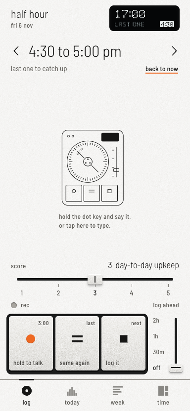
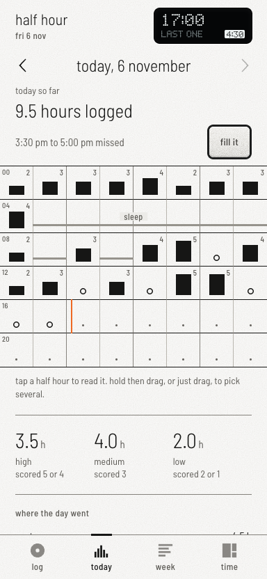
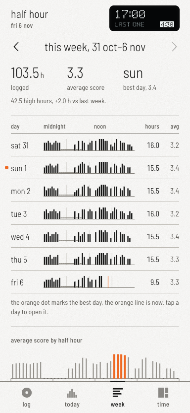
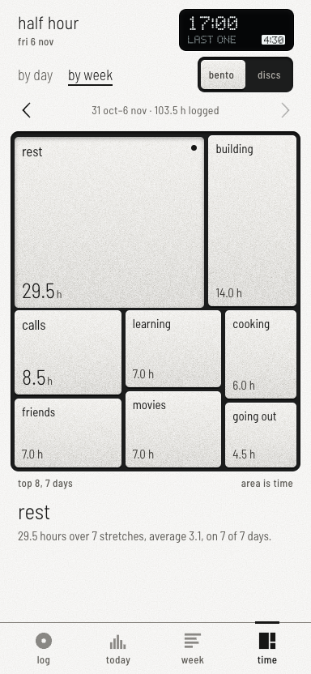

# Half Hour

An Android app that asks one question every half hour: what did you just do? You answer in a few words, slide a score from
1 to 5, and over a few days you get an honest picture of where your time goes.

No account, no server, no internet permission. Your log is one text file on your phone.

| Log | Today | Week | Time |
|---|---|---|---|
|  |  |  |  |

Screenshots use the built-in sample data.

## What it does

- **Log:** a ping on every :00 and :30. Type, or hold the left key to speak (its orange lamp glows), set a score, press log it. The screen opens on the
  half hour you last left off and walks you forward through anything you missed. Same again repeats your last entry in one press.
- **Keys and sliders:** three keys that press down for real: hold to talk, same again, log it. A thin slider sets the score. The recorder
  drawing's reel turns while you record.
- **Several half hours at once:** say or type "from 2 to 3 building, then coffee till 4". The app shows each span to check before
  it saves, and never overwrites an entry. This runs on the phone and reads clear English times; anything unclear saves as one entry.
- **Log ahead:** about to do the same thing for a while? The vertical fader saves the next 30 minutes, 1 hour or 2 hours too.
- **Today:** a full grid, one cell per half hour. Tap a cell to read it. Drag across cells, or hold and drag, to pick several in
  orange, then fill in the empty ones together. Below it: high, medium and low productivity hours, time per category, and the day's log.
- **Week:** hours and average score per day, and the time of day you do your best work, with the best day and best hours in orange.
- **Time:** your top 8 activities as one box split by time spent, by day or by week. A switch turns it into reel discs.
- **Sleep:** no pings from 2 to 10 am, and those hours count as sleep on their own.

The scale: 5 ultra productive, 4 fairly productive, 3 day-to-day upkeep, 2 less than that, 1 the worst.

## Try it without a phone

Open `assets/app.html` in a browser. With no phone behind it, the page runs on sample data, and every screen works.

## Build your own

You need a computer and an Android phone on Android 12 or later. No Android Studio or Gradle. Built on a Mac and tested on one
phone so far, a Galaxy S24 on Android 17.

```sh
brew install openjdk@17
brew install --cask android-commandlinetools android-platform-tools
sdkmanager "platforms;android-35" "build-tools;35.0.0"

git clone https://github.com/AshadMohammed/half-hour.git
cd half-hour
./build.sh
adb install -r build/halfhour.apk
```

Not using Homebrew, or on Linux? Set `ANDROID_HOME` and `JAVA_HOME` before running `build.sh`. To install without a cable, turn on wireless
debugging on the phone and run `adb pair`, then `adb connect`.

On first open, allow notifications. Allow the microphone if you want to speak your entries.

## Make it yours

The whole interface is one file, `assets/app.html`. Change it, run `./build.sh`, install again.

| To change | Look for |
|---|---|
| Your categories | `actOf` in `assets/app.html`, a list of keywords per category |
| Sleep hours | `quietA` and `quietB` in the page, `quietStart` and `quietEnd` in `Data.java` |
| High, medium, low | the score checks in `renderToday` and `renderWeek` |
| Number of activities in Time | `TIME_BUBBLE_LIMIT` |
| Colours | the colour variables at the top of the page, first block of styles |

A coding agent handles all of this well. Point it at this repo and describe what you want different.

## How it's put together

A small Java shell holds a WebView, the half-hourly alarm, the notification and speech. Everything you see is `app.html`, which
talks to the shell through one bridge object.

Entries are saved one JSON object per line, and a later line for the same half hour replaces the earlier one:

```
Android/data/com.ash.halfhour/files/log.jsonl
```

## Privacy

The app has no internet permission, so it can't send your log anywhere. Voice entries go through your phone's own speech
service, and what that does with audio depends on your phone's settings. The log sits in the app's folder on shared storage,
so anything with access to that folder, including a cable to your computer, can read it.

## Licence

MIT. The Barlow Semi Condensed font is under the SIL Open Font Licence, included in `assets/fonts/`.
